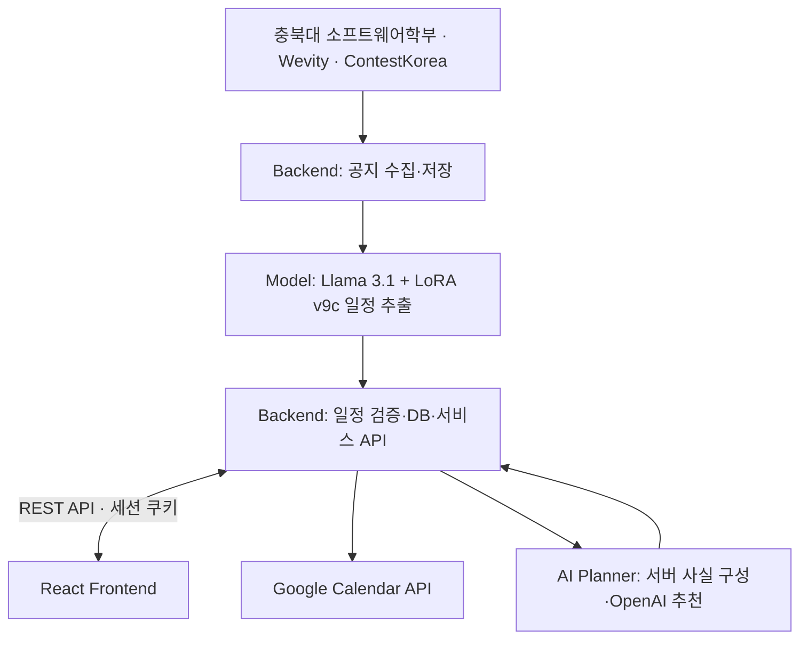

# NotiAI — Frontend

> 다중 프롬프트 기반 AI 대학생 일정 자동 생성 시스템  
> 충북대학교 소프트웨어학부 졸업작품

학교 공지, 공모전, 대외활동 안내는 여러 사이트에 흩어져 있습니다. 학생은 공지마다 신청 마감일과 행사 일정을 직접 찾아 비교하고, 놓치지 않도록 따로 기록해야 합니다.

**NotiAI**는 공지를 수집해 일정 정보를 추출하고, 이를 한 화면에서 탐색·관리할 수 있도록 만든 서비스입니다. 필요한 일정은 Google Calendar에 등록하고, AI Planner를 통해 지금 처리할 일과 새롭게 살펴볼 기회를 확인할 수 있습니다.

이 저장소는 NotiAI의 **웹 프론트엔드**입니다. 사용자 화면, PC·모바일 UI, 공지·일정 상태 관리, 백엔드 API 연동과 AI Planner 결과 표시를 담당합니다. 공지 수집, 일정 추출 모델 실행, Google Calendar API 호출과 추천 생성은 별도 서버에서 처리합니다.

- [Backend — 서비스 API 및 크롤러](https://github.com/capstonenotiai/backend/tree/feature/service-v9)
- [Model — 공지 일정 추출 모델](https://github.com/capstonenotiai/model)
- [AI Planner 다중 프롬프트 설계](docs/AI_PLANNER.md)

## 주요 기능

| 화면 | 주요 기능 | 구현 |
| --- | --- | --- |
| 홈 | 다가오는 일정과 공지 현황 확인 | [`DashboardPage.jsx`](src/pages/DashboardPage.jsx) |
| 전체 공지 | 키워드 검색, 분야·출처 필터, 공지별 일정과 원문 확인 | [`SchedulesPage.jsx`](src/pages/SchedulesPage.jsx) |
| 일정 관리 | 관심 저장, 숨김, 진행 상태 변경, 일정 정보 확인·수정 | [`eventService.js`](src/services/eventService.js) |
| 캘린더 | 등록 일정의 월간 조회, 날짜·분야별 탐색, 일정 상세 확인 | [`CalendarPage.jsx`](src/pages/CalendarPage.jsx) |
| AI Planner | 목적별 추천, 추천 이유, 다음 행동, 활동 간 비교 결과 확인 | [`PlannerPage.jsx`](src/pages/PlannerPage.jsx) |
| 설정 | 프로필, 관심분야, 수집 출처 및 알림 설정 | [`SettingsPage.jsx`](src/pages/SettingsPage.jsx) |

알림함과 피드백 화면도 포함합니다. 일정 등록 시 날짜 확인이 필요한 경우에는 수정·확인 단계를 거치며, 일반 일정과 면접 일정의 등록 흐름을 구분합니다.

### AI Planner: 서로 다른 세 가지 판단

| 화면 명칭 | 모드 ID | 해결하려는 질문 |
| --- | --- | --- |
| 먼저 할 일 | `priority` | 지금 무엇부터 처리해야 하는가? |
| 새 기회 | `discover` | 나에게 맞는 활동을 더 찾아볼 필요가 있는가? |
| 집중할 것 | `focus` | 어떤 활동을 우선하고 무엇을 미룰 것인가? |

세 모드는 화면 문구만 다른 기능이 아닙니다. 백엔드에서 후보 선정, 프롬프트, 출력 필드와 검증 규칙을 구분하며 프론트는 해당 결과를 모드에 맞게 표시합니다. 자세한 내용은 [AI Planner 설계 문서](docs/AI_PLANNER.md)에 정리했습니다.

## 시스템 구조



**일정 추출 모델과 AI Planner는 서로 다른 역할**을 맡습니다. 추출 모델은 공지에서 신청·제출·행사·면접 일정을 구조화합니다. AI Planner는 저장된 일정과 사용자 상태를 이용해 활동을 평가하고 추천 이유를 제공합니다. 프론트엔드는 이 결과를 사용자가 확인하고 행동할 수 있는 화면으로 연결합니다.

## 프론트엔드 설계

### 화면 사이에서 일관된 일정 상태 유지

- [`AppDataContext`](src/context/AppDataContext.jsx)는 공지·캘린더 일정·관심 저장 상태와 등록 동작을 여러 화면에서 공유합니다.
- [`UserContext`](src/context/UserContext.jsx)는 사용자 프로필·관심분야·수집 출처 설정을 관리합니다.
- 일정 등록이나 수정 요청이 끝나면 관련 정보를 다시 조회합니다. API 요청이 일부만 성공했거나 재조회가 실패한 경우에도 이전 화면 데이터를 서버의 최신 상태로 오인하지 않도록 구성했습니다.

### PC와 모바일에 맞춘 탐색 방식

- PC에서는 사이드바로 주요 화면을 이동하고, 모바일에서는 하단 탭과 추가 메뉴를 사용합니다.
- 캘린더는 PC에서 월간 일정 막대·항목을 보여주고, 모바일에서는 날짜별 일정 목록과 이달 목록을 중심으로 구성했습니다.
- 공지 검색·필터 및 일정 상세 화면은 화면 크기에 따라 배치를 조정하고, 팝업·대화상자에서는 키보드 조작과 포커스 복귀를 고려했습니다.

### 화면과 데이터 접근 분리

컴포넌트는 [`src/services/`](src/services) 계층을 통해 데이터를 요청합니다. 각 서비스는 환경 설정에 따라 Mock 데이터 또는 백엔드 API를 사용하므로, UI 개발 단계와 실데이터 연결 단계를 구분할 수 있습니다.

```text
src/
├── pages/        화면별 구성
├── components/   공통 UI 및 공지·일정 컴포넌트
├── layouts/      공통 화면 레이아웃
├── context/      사용자·일정 상태 관리
├── services/     API 요청 및 Mock 데이터 접근
├── config/       화면·모드·환경 설정
├── hooks/        공통 인터랙션·반응형 훅
├── utils/        날짜·캘린더·Planner 처리
└── styles/       공통·화면별 스타일

tests/            화면·서비스·계약 테스트
functions/        Cloudflare Pages Functions 코드
reference/        초기 웹 디자인 참고 자료
```

## 기술 스택

| 구분 | 기술 |
| --- | --- |
| UI | React 19, JavaScript |
| 개발·빌드 | Vite 8, Node.js 20.19 이상 |
| 라우팅 | React Router 7 |
| 스타일 | CSS, Pretendard |
| 상태 관리 | React Context API, Hooks |
| 통신 | Fetch API, 세션 쿠키(`credentials: 'include'`) |
| 테스트 | Node.js 내장 테스트 러너 |
| 정적 빌드 | Cloudflare Pages를 고려한 `dist/` 산출물 |

## 로컬 실행

```bash
npm ci
npm run dev
```

개발 서버의 기본 주소는 `http://localhost:5173`입니다. **환경변수를 지정하지 않으면 기본적으로 Mock 데이터를 사용**합니다.

```bash
npm test          # 저장소에 포함된 테스트 실행
npm run build     # 정적 파일 생성: dist/
npm run preview   # 빌드 결과 확인
```

### FastAPI 백엔드 연결

[`.env.example`](.env.example)을 참고해 저장소 루트에 `.env.local`을 만들고 실행 환경에 맞는 값을 설정합니다.

```dotenv
VITE_USE_MOCK=false
VITE_PLANNER_USE_MOCK=false
VITE_API_BASE_URL=http://localhost:8000
```

| 설정 | 설명 |
| --- | --- |
| `VITE_USE_MOCK` | `false`이면 공지·사용자·캘린더 등의 실제 API 사용 |
| `VITE_PLANNER_USE_MOCK` | `false`이면 AI Planner 추천·채팅 API 사용. 미설정이면 `VITE_USE_MOCK`을 따름 |
| `VITE_API_BASE_URL` | API 서버 주소. 비워두면 현재 웹 origin의 `/api/*`로 요청 |
| `VITE_MOCK_TODAY` | Mock 일정의 날짜 계산 기준 |

실제 로그인·일정 등록·추천 생성에는 별도로 실행 중인 백엔드와 데이터베이스, 관련 외부 API 설정이 필요합니다. 프론트와 백엔드가 서로 다른 origin에 있으면 CORS·쿠키·OAuth 리디렉션 설정도 맞아야 합니다.

`VITE_` 값은 브라우저 빌드 결과에 노출되므로 API 키·OAuth Secret·DB 비밀번호 등을 입력하지 않습니다.

## 테스트·배포 확인

이 저장소에는 프론트 화면·서비스 계층·API 계약을 확인하는 테스트가 포함되어 있습니다. `npm test`와 `npm run build`로 로컬에서 확인할 수 있으며, **이 README는 테스트 실행 결과나 운영 환경의 정상 동작을 보증하는 문서는 아닙니다.**

Cloudflare Pages용 빌드는 `npm run build`, 출력 디렉터리는 `dist`입니다. 실제 배포에 적용된 브랜치와 환경변수는 배포 설정에서 별도로 확인해야 합니다. `functions/`에 남아 있는 Pages Functions와 FastAPI의 **3모드 추천 API**는 구별해야 하며, 랜딩 페이지의 공지·Planner 미리보기는 실제 데이터가 아닌 화면 예시입니다.

최종 시연에서는 동일한 환경에서 **공지 데이터 조회 → 일정 등록 및 Google Calendar 반영 → Planner 세 모드 응답**을 확인해야 합니다. 개인정보처리방침·이용약관 페이지는 현재 안내 화면으로 구현되어 있어 정식 공개 전에 별도 보완이 필요합니다.

## 개발 담당

| 담당 | 주요 작업 |
| --- | --- |
| 조재영 | 프론트엔드 개발, UI/UX 설계, 사용자 화면 흐름, AI Planner 모드·프롬프트 설계 및 검토 |
| 조윤정 | 백엔드 API·데이터 처리, 일정 추출 모델, 서버 연동 |

---

이 문서는 Frontend `feature/service-v9`(기준 커밋 `6c076b9a66f1`)와 연결된 Backend `feature/service-v9`의 코드 구조를 기준으로 작성했습니다.