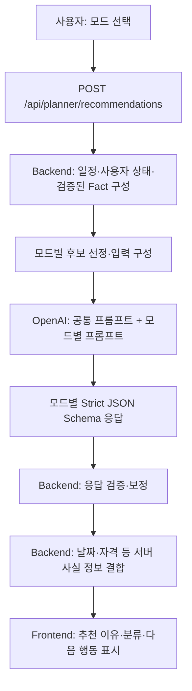

# AI Planner — 다중 프롬프트 설계와 구현

NotiAI는 공지에서 날짜를 추출하는 데서 끝나지 않고, 학생이 **어떤 일을 먼저 처리하고, 어떤 기회를 검토하며, 무엇에 집중할지** 결정할 수 있도록 AI Planner를 제공합니다.

AI Planner는 [일정 추출 모델](https://github.com/capstonenotiai/model)과 구분되는 추천 기능입니다. 백엔드가 공지·일정·사용자 정보에서 사실과 후보를 구성하고, GPT는 선택한 목적에 맞춰 판단 이유를 작성합니다.

## 설계 배경: 관심분야와 판단 목적의 분리

처음에는 공부·탐색·균형처럼 사용자 상황에 따라 추천 모드를 나누는 방식을 검토했습니다. 하지만 카테고리만 바꾸거나 비슷한 추천 문장을 반복하는 것으로는 모드가 달라야 하는 이유가 명확하지 않았습니다.

이를 해결하기 위해 추천을 두 축으로 나누었습니다.

- **WHAT — 관심분야:** 사용자가 어떤 분야의 공지를 보고 싶은지 설정합니다.
- **HOW — 판단 목적:** 같은 공지를 두고 지금 할 일, 새로운 기회, 집중할 활동 중 어떤 결정을 내릴지 선택합니다.

현재 구현된 HOW는 **PRIORITY / DISCOVER / FOCUS**입니다. 세 모드는 프롬프트 문장뿐 아니라 **후보 선정, GPT에 전달하는 정보, 출력 구조와 사후 검증**까지 다르게 설계되어 있습니다.

## 처리 구조



핵심은 **서버가 확인 가능한 사실을 계산하고, GPT는 그 사실을 바탕으로 설명과 평가를 맡는 분업**입니다. 날짜·지원 조건·우선순위·일정 충돌 등 구조화된 값은 서버에서 만들고, 최종 응답에도 서버 값을 결합합니다. GPT 설명문의 부정확한 추론까지 완전히 없애는 것은 아니므로, 프롬프트 제약과 사후 검증을 함께 적용합니다.

실제 구현은 다음 파일에서 확인할 수 있습니다.

| 단계 | 핵심 코드 |
| --- | --- |
| 사실 구성 | [`planner_facts.py`](https://github.com/capstonenotiai/backend/blob/feature/service-v9/app/services/planner_facts.py) |
| 후보 선정·모드별 입력 | [`planner_context.py`](https://github.com/capstonenotiai/backend/blob/feature/service-v9/app/services/planner_context.py) |
| 공통·모드별 프롬프트 | [`planner_prompts.py`](https://github.com/capstonenotiai/backend/blob/feature/service-v9/app/services/planner_prompts.py) |
| GPT 호출·결과 조합 | [`planner_recommendations.py`](https://github.com/capstonenotiai/backend/blob/feature/service-v9/app/services/planner_recommendations.py) |
| 응답 검증 | [`planner_validation.py`](https://github.com/capstonenotiai/backend/blob/feature/service-v9/app/services/planner_validation.py) |

## 세 모드 비교

| | PRIORITY | DISCOVER | FOCUS |
| --- | --- | --- | --- |
| 화면 이름 | 먼저 할 일 | 새 기회 | 집중할 것 |
| 질문 | 지금 무엇부터 처리할까? | 나에게 맞는 기회는 무엇일까? | 무엇을 선택하고 미룰까? |
| 핵심 기준 | 마감·필수 여부·행동 시점 | 관심·자격·정보 확실성 | 유사 활동·일정 충돌·적합성 |
| 후보 상한 | 15건 | 20건 | 12건 |
| 출력 분류 | 지금 진행 / 미리 준비 / 확인 필요 / 추후 확인 | 적극 추천 / 검토 추천 / 추천 안 함 | 핵심 / 후순위 |

후보 상한은 한 번의 추천 요청에 입력하는 활동 수이며, 전체 수집 공지의 개수가 아닙니다.

### 1. PRIORITY — 먼저 할 일

**목표:** 일정의 처리 순서를 정하고 바로 다음 행동을 제안합니다.

서버의 `priority_sort_key()`는 **사용자가 관리 중인 활동, 낮은 학생 적합성 여부, 마감 긴급도, 필수 일정 여부, 조기 마감, 행동 가능 시점, 날짜** 등을 순서대로 비교합니다. 각각에 숫자 가중치를 곱해 점수를 합산하는 방식이 아니라, **정해진 우선순위의 규칙 기반 정렬**입니다.

GPT는 이 순서를 유지하고 각 활동의 `reason`(이유)과 `next_action`(다음 행동)을 작성합니다. 행동 분류는 서버가 계산한 `priority_context.next_step_type`을 사용합니다.

| 결과 코드 | 화면 표시 | 용도 |
| --- | --- | --- |
| `act` | 지금 진행 | 현재 실행할 수 있는 행동 안내 |
| `prepare` | 미리 준비 | 검증된 준비 항목이 있을 때 준비 안내 |
| `verify` | 확인 필요 | 날짜·일정 묶음·신청 완료 여부 등의 확인 안내 |
| `monitor` | 추후 확인 | 당장 처리할 일이 없는 활동 추적 |

준비물이나 신청 방법은 해당 공지에서 **근거가 검증된 경우에만** 구체적으로 설명하도록 지시합니다. GPT가 임의로 마감 순서나 행동 유형을 변경하지 않게 후처리에서도 확인합니다.

### 2. DISCOVER — 새 기회

**목표:** 관심과 지원 조건에 맞는 활동을 평가해 새롭게 검토할 기회를 제시합니다.

서버는 지원 불가가 명확하거나 숨김·완료·만료 상태인 후보를 걸러내고, 관심 연결 및 정보 확실성을 고려합니다. 행동 날짜가 확인된 활동은 원칙적으로 **2일 이상 여유가 있어야** 후보가 되며, 사용자가 이미 관리 중인 활동 등은 예외입니다.

관심 연관성은 공지 카테고리가 설정된 관심분야와 일치하거나, **근거가 확인된 관련 관심 Fact**가 있을 때 판단합니다. 제목에 특정 단어가 있다는 사실만으로 혜택이나 지원 자격을 추측하지 않습니다.

| 결과 코드 | 화면 표시 | 의미 |
| --- | --- | --- |
| `strong_match` | 적극 추천 | 관심·자격·근거가 비교적 충분한 활동 |
| `potential_match` | 검토 추천 | 관심은 있으나 확인할 조건이 있는 활동 |
| `not_recommended` | 추천 안 함 | 현재 조건에서 우선 추천하지 않는 활동 |

서버는 지원 자격이 불명확하거나 보강된 정보의 신뢰도가 낮은 경우 `strong_match`로 확정되지 않도록 **추천 등급의 상한**을 적용합니다. 확인할 조건은 `check_reasons`에 담깁니다.

화면의 '새 기회'는 추천 목적을 뜻합니다. 현재 `new_to_user`는 `null`이며, **사용자가 처음 본 공지인지 추적하는 기능은 구현되어 있지 않습니다.**

### 3. FOCUS — 집중할 것

**목표:** 서로 비교할 만한 활동 사이에서 핵심과 후순위를 정합니다.

DISCOVER와 유사한 기본 제외 조건을 거친 뒤 관심 연결이 있는 후보를 사용합니다. 목적·활동 형태가 비슷하거나 서버가 실제 일정 충돌을 확인한 경우 비교할 수 있습니다. 서로 다른 목적의 활동을 무조건 경쟁시키지 않으므로 **핵심 활동이 여러 개일 수도 있습니다.**

| 결과 코드 | 화면 표시 | 의미 |
| --- | --- | --- |
| `core` | 핵심 | 우선 집중할 활동 |
| `secondary` | 후순위 | 비교 결과 나중에 검토할 활동 |

후순위 사유는 `stronger_alternative`(더 적합한 대안), `schedule_conflict`(일정 충돌), `information_uncertain`(정보 확인 필요)으로 구분합니다. `chosen_over`와 `conflicts_with`는 활동 간 관계를 나타내며, 서버는 입력에 존재하지 않는 관계를 제거하거나 수정합니다.

일정 충돌은 **NotiAI 서비스에서 확인할 수 있는 일정**을 기준으로 판단합니다. Google Calendar에만 존재하는 개인 일정 전체를 불러와 비교하는 기능은 아닙니다. 또한 충돌 정보가 `null`이면 '충돌 없음'이 아니라 '확인하지 못함'입니다.

## 동일한 공지를 서로 다르게 처리하는 예

아래는 **설계 동작을 설명하기 위한 가상 사례**입니다. 실제 GPT 응답을 복사하거나 성능 평가 결과로 제시한 것은 아닙니다.

학생은 공모전에 관심이 있고, 아래 활동은 모두 관심분야와 지원 조건이 맞는다고 가정합니다. 별도 관심 저장·캘린더 등록은 하지 않았으며, 날짜와 활동 유형은 서버에서 정상 확인한 상태입니다.

| 공지 | 상황 |
| --- | --- |
| A: 아이디어 공모전 | 신청 마감 **D-1**, 아직 관리하지 않음 |
| B: 소프트웨어 해커톤 | 신청 마감 **D-10** |
| C: 개발 해커톤 | 신청 마감 **D-12**, B와 실제 참여 일정이 겹침 |

| 모드 | 가상 사례에서의 처리 방식 |
| --- | --- |
| **PRIORITY** | A도 후보에 포함될 수 있으며, 다른 우선 조건이 같다면 급한 마감이 먼저 배치됩니다. 다음 행동은 서버가 정한 행동 유형에 따라 안내합니다. |
| **DISCOVER** | A는 마감까지 1일뿐이고 관리 중인 활동도 아니므로 **2일 여유 규칙에 따라 후보에서 제외**됩니다. B·C는 자격·관심·확인할 조건을 각각 평가받습니다. |
| **FOCUS** | A는 위와 같은 여유 조건으로 제외됩니다. B·C는 실제 참여 시간이 충돌하는 것으로 확인되었다면 비교 관계가 입력되며, `core`·`secondary` 및 사유를 판단합니다. |

**핵심은 동일한 세 공지를 입력한다고 해서 세 모드의 후보와 결과가 같아야 하는 것이 아니라는 점**입니다. PRIORITY는 행동 순서, DISCOVER는 기회 적합성, FOCUS는 선택의 우선순위를 다룹니다. 위 예시의 최종 추천 등급·분류는 실제 서비스 실행 결과와 다를 수 있습니다.

## 프롬프트 구성과 출력 형식

현재 백엔드 프롬프트 버전은 **`planner-v7`**입니다. 실제 프롬프트는 다음과 같이 합쳐집니다.

```python
def instructions_for(mode):
    return BASE_PROMPT + '\n\n' + MODE_PROMPTS[mode]
```

- **`BASE_PROMPT`**: 서버 사실 존중, 근거 참조, 내부 ID 비노출, 미확인 정보 단정 금지 등 공통 원칙
- **`MODE_PROMPTS`**: PRIORITY의 다음 행동, DISCOVER의 적합성, FOCUS의 비교 관계를 판단하는 별도 지시
- **`schema_for(mode)`**: 모드별 필드와 허용값을 지정하는 Strict JSON Schema

| 구분 | GPT 응답에 요구하는 필드 |
| --- | --- |
| 공통 | `opportunity_id`, `reason`, `fact_refs` |
| PRIORITY | `next_step_label`, `next_action` |
| DISCOVER | `grade`, `check_reasons` |
| FOCUS | `tier`, `secondary_reason`, `chosen_over`, `conflicts_with` |

OpenAI Responses API에 **공통·모드별 지시, 후보 JSON, Strict JSON Schema**를 전달합니다. `fact_refs`는 추천 이유에 실제 사용한 공지 근거의 ID를 가리킵니다. 공지 제목과 Fact는 실행 지시가 아니라 **분석 자료**로 취급하도록 프롬프트에 명시했습니다.

개인정보 처리 범위도 구분합니다. [`planner_context.py`](https://github.com/capstonenotiai/backend/blob/feature/service-v9/app/services/planner_context.py)는 **GPT에 전달할 검증된 Fact의 `value`** 안에 포함된 이메일·전화번호 패턴을 마스킹합니다. 입력 전체의 모든 문자열을 일괄 익명화하는 것은 아닙니다.

실제 GPT 모델명은 백엔드 환경 설정에서 결정됩니다. 프론트에 고정된 안내 문구만으로 운영 모델을 확정하지 않습니다.

## 응답 검증과 프론트 연동

GPT 응답은 [`planner_validation.py`](https://github.com/capstonenotiai/backend/blob/feature/service-v9/app/services/planner_validation.py)를 통과한 후 서버가 계산한 사실 필드와 합쳐집니다.

| 검증 대상 | 주요 처리 |
| --- | --- |
| 활동 식별자 | 입력에 없는·중복된 ID 제거, 누락된 후보 복원 |
| PRIORITY | 서버의 출력 순서·행동 유형 유지 |
| 근거 참조 | 허용되지 않은 Fact ID 제거, 사용자 문장의 내부 코드 정리 |
| DISCOVER | 자격·정보의 확실성에 따른 추천 등급 상한 적용 |
| FOCUS | 비교 대상·충돌 관계·후순위 사유의 일관성 확인 |
| 불완전한 응답 | 가능한 범위에서 보수적인 기본 분류·문장으로 보정 |

이 단계는 **구조적 일관성을 지키기 위한 검증**입니다. 이유 문장에 포함된 모든 의미적 추론이 참임을 보장하지는 않습니다.

프론트는 다음과 같이 모드별 추천을 요청합니다.

```http
POST /api/planner/recommendations
Content-Type: application/json

{"mode":"priority"}
```

- `refresh: true`는 새 추천을 요청하는 옵션입니다. 서버는 사용자·모드별 새로 받기에 **60초 제한**을 적용합니다.
- 추천 결과는 브라우저와 서버에서 **최대 30분간 캐시**합니다. 서버 캐시는 프로세스 메모리 기반으로, 프로세스 간 공유되거나 재시작 후 보존되지 않습니다.
- 프론트의 [`PlannerPage.jsx`](../src/pages/PlannerPage.jsx)는 결과 로딩·오류·재시도, 모드 전환, 추천 시간·분류·상세 정보를 표시합니다.
- Mock 추천, 랜딩 페이지의 정적 미리보기, 별도 자유형 채팅 API(`/api/planner/chat`)는 **실제 3모드 추천과 다른 경로**입니다.

## 개발·검증 범위

세 모드를 구분하는 과정에서 프롬프트의 말투보다 **후보 선정과 판단 목적을 분리하는 것**에 중점을 두었습니다. 지원 자격, 날짜, 관심 연결, 일정 충돌을 서버에서 계산하고 GPT에는 판단에 필요한 근거만 전달하도록 구성했습니다. 이 설계에서 특히 중요했던 것은 '왜 추천하는가'뿐 아니라 **'지금 무엇을 해야 하는가'와 '다른 활동보다 왜 우선하는가'**를 구분하는 일이었습니다.

백엔드에는 후보 선정, 출력 스키마, 보정 규칙 및 API에 대한 테스트 코드가 포함되어 있습니다. 다만 이 문서는 **과거 프롬프트 실험 횟수나 교차검토 결과를 현재 `planner-v7`의 측정 성능으로 주장하지 않습니다.** 실제 GPT 출력 품질과 운영 환경의 종단 간 동작은 실데이터 기반 테스트로 별도 확인해야 합니다.

현재 구현에는 다음과 같은 범위 제한이 있습니다.

- DISCOVER의 실제 사용자별 '처음 본 공지' 판별(`new_to_user`)은 구현되지 않았습니다.
- FOCUS는 Google Calendar에만 있는 외부 일정을 전부 조회하지 않습니다.
- 추천 품질은 입력 공지의 완전성, 추출된 일정, 확인 가능한 Fact에 영향을 받습니다.

## 관련 프론트엔드 코드

- [모드 정의 및 화면 문구](../src/config/aiModes.js)
- [Planner 추천 화면](../src/pages/PlannerPage.jsx)
- [추천 API 요청·Mock 분기](../src/services/plannerService.js)
- [출력 라벨·브라우저 캐시](../src/utils/planner.js)

---

문서 기준: Frontend `feature/service-v9` (`6c076b9a66f1`), Backend `feature/service-v9` (`763abe5c260c`).